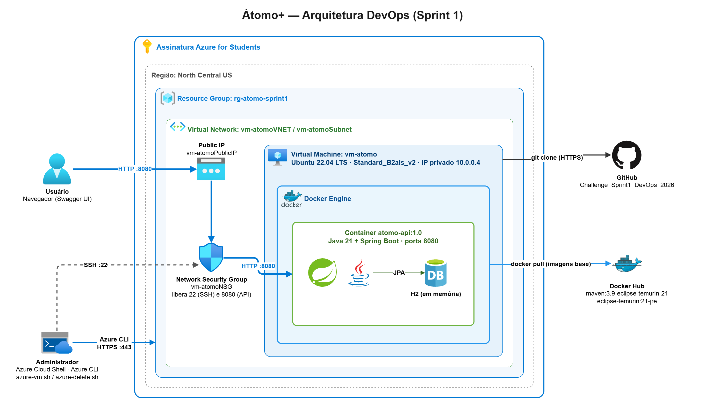

# Átomo+ — DevOps Tools & Cloud Computing (Sprint 1)

Prova de conceito do **Challenge CTMSP 2026** (FIAP · Marinha do Brasil / AMAZUL) demonstrando como a API do **Átomo+**, plataforma educativa sobre as aplicações benéficas da tecnologia nuclear, é empacotada com **Docker** e executada em uma **máquina virtual no Microsoft Azure** provisionada via **Azure CLI**.

## Integrantes — Turma 2TDSPS

| Nome | RM |
|------|----|
| Gustavo Siciliano | RM568419 |
| Gustavo de Jesus | RM567926 |
| Manuel Gouveia | RM567458 |
| Samuel Keniti | RM567614 |
| Vinicius Morrone | RM566884 |

## Sobre a aplicação

A aplicação em container é a **API REST do quiz** do Átomo+ (Java 21 + Spring Boot), reutilizada da disciplina de Java Advanced conforme permitido pelo enunciado: [Challenge_Sprint1_Java_2026](https://github.com/GustavoSiciliano/Challenge_Sprint1_Java_2026).

- CRUD de perguntas do quiz (4 alternativas, 1 correta), separadas por categoria (CRIANCA, JOVEM, ADULTO) e setor de aplicação nuclear
- Banco **H2 em memória** com 9 perguntas carregadas automaticamente na inicialização
- Documentação **Swagger / OpenAPI**
- Porta **8080**

## Arquitetura



O administrador executa o script `azure-vm.sh` no **Azure Cloud Shell**, que usa o **Azure CLI** para criar o grupo de recursos `rg-atomo-sprint1` e a VM `vm-atomo` (Ubuntu 22.04, `Standard_B2als_v2`, região North Central US) com rede virtual, IP público e Network Security Group liberando as portas 22 (SSH) e 8080 (API). Em seguida, o script instala o Docker na VM, clona este repositório do GitHub, gera a imagem a partir do `Dockerfile` (baixando as imagens base do Docker Hub) e executa o container `atomo-api`. O usuário acessa a API pelo navegador através do **IP público da VM na porta 8080**. Ao final, o script `azure-delete.sh` exclui o grupo de recursos inteiro.

Arquivo editável do diagrama: [`docs/arquitetura.drawio`](docs/arquitetura.drawio).

## Dockerfile

```dockerfile
# Estágio 1: build
FROM maven:3.9-eclipse-temurin-21 AS build
WORKDIR /app
COPY pom.xml .
RUN mvn -q dependency:go-offline
COPY src ./src
RUN mvn -q clean package -DskipTests

# Estágio 2: execução
FROM eclipse-temurin:21-jre
WORKDIR /app
COPY --from=build /app/target/*.jar app.jar
EXPOSE 8080
ENTRYPOINT ["java", "-jar", "app.jar"]
```

O Dockerfile usa **multi-stage build**:

1. **Build**: a imagem `maven:3.9-eclipse-temurin-21` baixa as dependências (copiando primeiro só o `pom.xml`, para aproveitar o cache de camadas) e compila o projeto, gerando o `.jar`.
2. **Execução**: apenas o `.jar` é copiado para a imagem `eclipse-temurin:21-jre`, que contém só o runtime do Java. A imagem final fica menor e sem ferramentas de build.

O `.dockerignore` evita enviar `target`, `.git`, `.idea` e arquivos `.md` para o build.

## Comandos Azure CLI utilizados

### `azure-vm.sh` — provisionamento da VM e execução do container

```bash
#!/bin/bash
set -e

RG="rg-atomo-sprint1"
LOCATION="northcentralus"
VM_NAME="vm-atomo"
ADMIN="azureuser"
IMAGE="Ubuntu2204"
SIZE="Standard_B2als_v2"
PORT=8080
REPO_URL="https://github.com/viniciusmorrone/Challenge_Sprint1_DevOps_2026.git"

# 1. Grupo de recursos
az group create --name $RG --location $LOCATION -o table

# 2. VM
az vm create \
  --resource-group $RG \
  --name $VM_NAME \
  --image $IMAGE \
  --size $SIZE \
  --admin-username $ADMIN \
  --generate-ssh-keys \
  --public-ip-sku Standard -o table

# 3. Abrir porta da API
az vm open-port --resource-group $RG --name $VM_NAME --port $PORT --priority 1010 -o none

# 4. Comprovar provisionamento
az vm show -d -g $RG -n $VM_NAME \
  --query "{Nome:name, Estado:powerState, IP:publicIps, Local:location}" -o table

# 5. Docker + clone + build + run dentro da VM
az vm run-command invoke -g $RG -n $VM_NAME --command-id RunShellScript \
  --query "value[0].message" -o tsv --scripts "
  apt-get -o DPkg::Lock::Timeout=300 update -y &&
  apt-get -o DPkg::Lock::Timeout=300 install -y docker.io git &&
  systemctl enable --now docker &&
  rm -rf /tmp/app && git clone $REPO_URL /tmp/app &&
  cd /tmp/app &&
  docker build -t atomo-api:1.0 . &&
  (docker rm -f atomo-api 2>/dev/null || true) &&
  docker run -d --name atomo-api -p $PORT:8080 atomo-api:1.0 &&
  docker ps
"

IP=$(az vm show -d -g $RG -n $VM_NAME --query publicIps -o tsv)
echo "Swagger:   http://$IP:$PORT/swagger-ui.html"
echo "Perguntas: http://$IP:$PORT/perguntas"
```

| Comando | Função |
|---------|--------|
| `az group create` | Cria o grupo de recursos `rg-atomo-sprint1` |
| `az vm create` | Cria a VM Ubuntu 22.04 com chave SSH, rede virtual, IP público e NSG |
| `az vm open-port` | Libera a porta 8080 no NSG para acesso à API |
| `az vm show -d` | Comprova o provisionamento (nome, estado, IP público e região) |
| `az vm run-command invoke` | Executa dentro da VM a instalação do Docker, o clone do repositório, o `docker build` e o `docker run` |

> A região `northcentralus` e o tamanho `Standard_B2als_v2` (2 vCPU, 4 GB) foram escolhidos por estarem liberados pela política da assinatura Azure for Students do grupo.

### `azure-delete.sh` — exclusão do grupo de recursos

```bash
#!/bin/bash
RG="rg-atomo-sprint1"
az group delete --name $RG --yes --no-wait
az group wait --name $RG --deleted
az group exists --name $RG   # false = excluído
```

| Comando | Função |
|---------|--------|
| `az group delete` | Exclui o grupo de recursos e tudo o que há nele (VM, disco, rede, IP, NSG) |
| `az group wait --deleted` | Aguarda a exclusão terminar |
| `az group exists` | Comprova a exclusão: retorna `false` |

## Como executar

**Pré-requisito:** assinatura ativa no Microsoft Azure. Recomenda-se o **Azure Cloud Shell (Bash)**, que já possui Azure CLI, Git e SSH autenticados. Caso a assinatura não permita a região ou o tamanho definidos, ajuste `LOCATION` e `SIZE` no `azure-vm.sh`.

1. Clonar o repositório no Cloud Shell:
   ```bash
   git clone https://github.com/viniciusmorrone/Challenge_Sprint1_DevOps_2026.git
   cd Challenge_Sprint1_DevOps_2026
   ```
2. Provisionar a VM e subir o container:
   ```bash
   bash azure-vm.sh
   ```
3. Acessar a API pelo IP público exibido ao final do script:
   - Swagger: `http://<IP_PUBLICO_DA_VM>:8080/swagger-ui.html`
   - Lista de perguntas: `http://<IP_PUBLICO_DA_VM>:8080/perguntas`
4. Conferir o container dentro da VM:
   ```bash
   ssh azureuser@<IP_PUBLICO_DA_VM>
   sudo docker ps
   exit
   ```
5. Excluir todos os recursos:
   ```bash
   bash azure-delete.sh
   ```

### Endpoints da API

| Método | Rota | Descrição |
|--------|------|-----------|
| GET | `/perguntas` | Lista as perguntas (filtro opcional `?categoria=JOVEM`) |
| GET | `/perguntas/{id}` | Consulta uma pergunta |
| GET | `/perguntas/busca?texto=radiacao` | Busca pelo texto do enunciado |
| POST | `/perguntas` | Cadastra uma pergunta |
| PUT | `/perguntas/{id}` | Atualiza uma pergunta |
| DELETE | `/perguntas/{id}` | Exclui uma pergunta |

## Como Docker e Cloud Computing podem ser utilizados na solução proposta pelo grupo?

O Átomo+ é uma plataforma educativa que usa conteúdo por faixa etária, quiz, pontuação e ranking para mostrar que a tecnologia nuclear está presente na saúde, na agricultura, na indústria, na pesquisa e na geração de energia. O **Docker** empacota a API do quiz (Java 21 + Spring Boot) com todas as suas dependências em uma única imagem, garantindo que ela execute da mesma forma na máquina de qualquer integrante e no servidor, sem diferenças de ambiente. A **computação em nuvem**, representada nesta entrega por uma VM no Microsoft Azure criada via Azure CLI, oferece à API um endereço público acessível pela internet, sem que o grupo precise manter infraestrutura própria. Juntos, permitem criar e excluir todo o ambiente por script em poucos minutos, publicar novas versões apenas gerando uma nova imagem e um novo container, pagar somente pelo tempo de uso dos recursos e aumentar a capacidade conforme cresce o número de usuários, escolas e museus atendidos. Nas próximas sprints, o mesmo modelo poderá hospedar o banco de dados, servir o aplicativo mobile e o agente de inteligência artificial, mantendo toda a plataforma em um único ambiente na nuvem.
