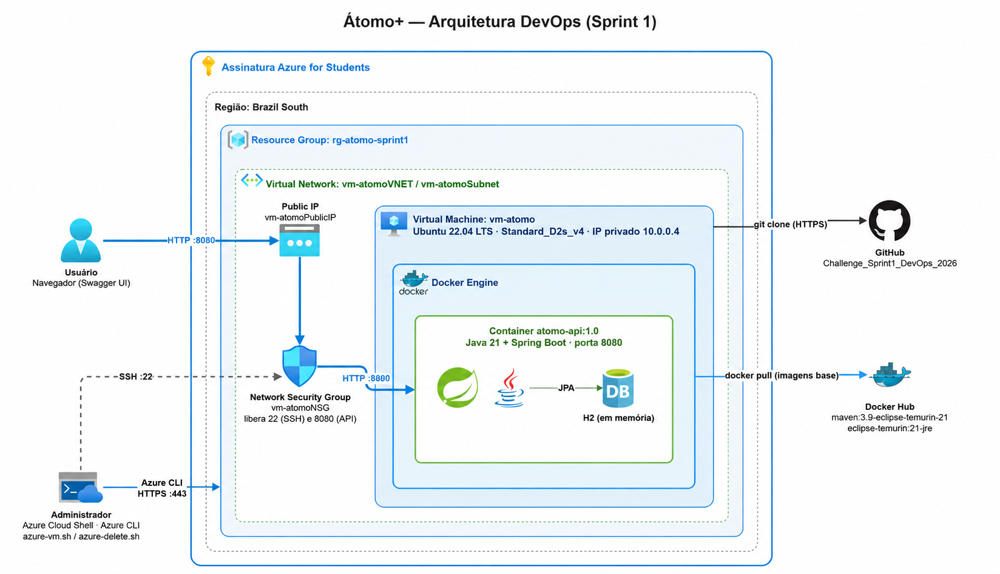

# Átomo+ - DevOps Tools & Cloud Computing (Sprint 1)

Prova de conceito do **Challenge CTMSP 2026** (FIAP - Marinha do Brasil / AMAZUL), demonstrando como a API do **Átomo+**, plataforma educativa sobre as aplicações benéficas da tecnologia nuclear, é empacotada com **Docker** e executada em uma **máquina virtual no Microsoft Azure**, provisionada via **Azure CLI**.

## Integrantes - Turma 2TDSPS

| Nome | RM |
|------|----|
| Gustavo Siciliano | RM568419 |
| Gustavo de Jesus | RM567926 |
| Manuel Gouveia | RM567458 |
| Samuel Keniti | RM567614 |
| Vinicius Morrone | RM566884 |

## Sobre a aplicação

A aplicação em container é a **API REST do quiz** do Átomo+ (Java 21 + Spring Boot), reutilizada da disciplina de Java Advanced conforme permitido pelo enunciado:

[Challenge_Sprint1_Java_2026](https://github.com/GustavoSiciliano/Challenge_Sprint1_Java_2026)

- CRUD de perguntas do quiz (4 alternativas, 1 correta), separadas por categoria (CRIANCA, JOVEM, ADULTO) e setor de aplicação nuclear.
- Banco **H2 em memória** com 9 perguntas carregadas automaticamente na inicialização.
- Documentação **Swagger / OpenAPI**.
- Porta **8080**.

## Arquitetura



O administrador executa o script `azure-vm.sh` no **Azure Cloud Shell**, que utiliza **Azure CLI** para criar o grupo de recursos `rg-atomo-sprint1` e a VM `vm-atomo` (Ubuntu 22.04, `Standard_D2s_v4`, região Brazil South).

A infraestrutura inclui rede virtual, IP público e Network Security Group com regras para as portas 22 (SSH) e 8080 (API).

Em seguida, o script instala o Docker na VM, clona este repositório do GitHub, gera a imagem a partir do `Dockerfile` (baixando as imagens base do Docker Hub) e executa o container `atomo-api`.

O usuário acessa a API pelo navegador ou por requisições HTTP através do **IP público da VM na porta 8080**.

Ao final, o script `azure-delete.sh` exclui o grupo de recursos inteiro.

Arquivo editável do diagrama: [`docs/arquitetura.drawio`](docs/arquitetura.drawio).

### Configuração utilizada na Azure

| Recurso | Configuração |
|---------|-------------|
| Grupo de recursos | `rg-atomo-sprint1` |
| Região | `brazilsouth` |
| Máquina virtual | `vm-atomo` |
| Sistema operacional | Ubuntu 22.04 |
| Tamanho da VM | `Standard_D2s_v4` |
| Processamento | 2 vCPUs |
| Memória RAM | 8 GB |
| Usuário | `azureuser` |
| Container | `atomo-api` |
| Imagem Docker | `atomo-api:1.0` |
| Porta | 8080 |

A região `brazilsouth` e o tamanho `Standard_D2s_v4` foram utilizados porque a assinatura Azure for Students empregada na demonstração não permitia o provisionamento na região `northcentralus` com o tamanho inicialmente previsto.

**Observação:** a infraestrutura foi excluída após a demonstração, conforme solicitado pelo professor. O endereço IP utilizado durante o teste não permanece ativo.

## Dockerfile

```dockerfile
# Estágio 1: build
FROM maven:3.9-eclipse-temurin-21 AS build
WORKDIR /app
COPY pom.xml .
RUN mvn -q dependency:go-offline
COPY src ./src
RUN mvn -q clean package -DskipTests

# Estágio 2: execução
FROM eclipse-temurin:21-jre
WORKDIR /app
COPY --from=build /app/target/*.jar app.jar
EXPOSE 8080
ENTRYPOINT ["java", "-jar", "app.jar"]
```

O Dockerfile utiliza **multi-stage build**:

1. **Build:** a imagem `maven:3.9-eclipse-temurin-21` baixa as dependências (copiando primeiro o `pom.xml` para aproveitar o cache de camadas) e compila o projeto, gerando o `.jar`.
2. **Execução:** apenas o `.jar` é copiado para a imagem `eclipse-temurin:21-jre`, que contém o runtime do Java. A imagem final fica menor e não inclui as ferramentas de compilação.

O `.dockerignore` evita enviar `target`, `.git`, `.idea` e arquivos `.md` para o contexto de build.

## Comandos Azure CLI utilizados

### `azure-vm.sh` - Provisionamento da VM e execução do container

```bash
#!/bin/bash
set -e

RG="rg-atomo-sprint1"
LOCATION="brazilsouth"
VM_NAME="vm-atomo"
ADMIN="azureuser"
IMAGE="Ubuntu2204"
SIZE="Standard_D2s_v4"
PORT=8080
REPO_URL="https://github.com/viniciusmorrone/Challenge_Sprint1_DevOps_2026.git"

# 1. Grupo de recursos
az group create --name $RG --location $LOCATION -o table

# 2. VM
az vm create \
  --resource-group $RG \
  --name $VM_NAME \
  --image $IMAGE \
  --size $SIZE \
  --admin-username $ADMIN \
  --generate-ssh-keys \
  --public-ip-sku Standard -o table

# 3. Abrir porta da API
az vm open-port --resource-group $RG --name $VM_NAME --port $PORT --priority 1010 -o none

# 4. Comprovar provisionamento
az vm show -d -g $RG -n $VM_NAME \
  --query "{Nome:name, Estado:powerState, IP:publicIps, Local:location}" -o table

# 5. Docker + clone + build + run dentro da VM
az vm run-command invoke -g $RG -n $VM_NAME --command-id RunShellScript \
  --query "value[0].message" -o tsv --scripts "
  apt-get -o DPkg::Lock::Timeout=300 update -y &&
  apt-get -o DPkg::Lock::Timeout=300 install -y docker.io git &&
  systemctl enable --now docker &&
  rm -rf /tmp/app && git clone $REPO_URL /tmp/app &&
  cd /tmp/app &&
  docker build -t atomo-api:1.0 . &&
  (docker rm -f atomo-api 2>/dev/null || true) &&
  docker run -d --name atomo-api -p $PORT:8080 atomo-api:1.0 &&
  docker ps
"

IP=$(az vm show -d -g $RG -n $VM_NAME --query publicIps -o tsv)
echo "Swagger:   http://$IP:$PORT/swagger-ui.html"
echo "Perguntas: http://$IP:$PORT/perguntas"
```

| Comando | Função |
|---------|--------|
| `az group create` | Cria o grupo de recursos `rg-atomo-sprint1` |
| `az vm create` | Cria a VM Ubuntu 22.04 com chave SSH, rede virtual, IP público e NSG |
| `az vm open-port` | Libera a porta 8080 no NSG para acesso à API |
| `az vm show -d` | Comprova o provisionamento (nome, estado, IP público e região) |
| `az vm run-command invoke` | Executa dentro da VM a instalação do Docker, o clone do repositório, o `docker build` e o `docker run` |

### `azure-delete.sh` - Exclusão do grupo de recursos

```bash
#!/bin/bash
RG="rg-atomo-sprint1"
az group delete --name $RG --yes --no-wait
az group wait --name $RG --deleted
az group exists --name $RG   # false = excluído
```

| Comando | Função |
|---------|--------|
| `az group delete` | Exclui o grupo e os recursos associados |
| `az group wait --deleted` | Aguarda a exclusão terminar |
| `az group exists` | Comprova a exclusão: retorna `false` |

## Como executar

**Pré-requisito:** assinatura ativa no Microsoft Azure, com permissão e cota para criação de máquinas virtuais.

Recomenda-se o **Azure Cloud Shell (Bash)**, que já possui Azure CLI, Git e SSH disponíveis.

Caso a assinatura não permita a região ou o tamanho definidos, ajuste `LOCATION` e `SIZE` no `azure-vm.sh`.

### 1. Clonar o repositório no Cloud Shell

```bash
git clone https://github.com/viniciusmorrone/Challenge_Sprint1_DevOps_2026.git
cd Challenge_Sprint1_DevOps_2026
```

### 2. Provisionar a VM e iniciar o container

```bash
bash azure-vm.sh
```

### 3. Verificar a máquina virtual

```bash
az vm show -d -g rg-atomo-sprint1 -n vm-atomo -o table
```

O resultado deverá apresentar a VM no estado `VM running`.

### 4. Verificar o Docker dentro da VM

```bash
az vm run-command invoke \
  -g rg-atomo-sprint1 \
  -n vm-atomo \
  --command-id RunShellScript \
  --scripts "sudo docker ps" \
  --query 'value[0].message' -o tsv
```

O resultado esperado apresenta o container `atomo-api`, com a imagem `atomo-api:1.0`, em execução na porta 8080.

### 5. Testar a API

Obter o IP público:

```bash
IP=$(az vm show -d -g rg-atomo-sprint1 -n vm-atomo --query publicIps -o tsv)
```

Consultar as perguntas:

```bash
curl -i "http://$IP:8080/perguntas"
```

O resultado esperado é uma resposta HTTP `200 OK`, acompanhada das perguntas em formato JSON.

### 6. Excluir todos os recursos

```bash
bash azure-delete.sh
```

Confirmar a exclusão:

```bash
az group exists --name rg-atomo-sprint1
```

Resultado esperado:

```text
false
```

**Atenção:** o comando de exclusão remove permanentemente os recursos pertencentes ao grupo `rg-atomo-sprint1`.

## Endpoints da API

| Método | Rota | Descrição |
|--------|------|-----------|
| GET | `/perguntas` | Lista as perguntas (filtro opcional `?categoria=JOVEM`) |
| GET | `/perguntas/{id}` | Consulta uma pergunta |
| GET | `/perguntas/busca?texto=radiacao` | Busca pelo texto do enunciado |
| POST | `/perguntas` | Cadastra uma pergunta |
| PUT | `/perguntas/{id}` | Atualiza uma pergunta |
| DELETE | `/perguntas/{id}` | Exclui uma pergunta |

## Resultados da execução na Azure - 03/11/2026

A equipe realizou o provisionamento da infraestrutura e a execução da aplicação na região Brazil South, utilizando uma assinatura Azure for Students.

Os seguintes resultados foram confirmados:

| Verificação | Resultado |
|------------|-----------|
| Grupo de recursos criado | `rg-atomo-sprint1` |
| VM provisionada via Azure CLI | `vm-atomo` |
| Região | `brazilsouth` |
| Tamanho | `Standard_D2s_v4` |
| Estado da VM durante o teste | `VM running` |
| Instalação do Docker | Concluída |
| Construção da imagem Docker | `Successfully built` |
| Imagem gerada | `atomo-api:1.0` |
| Container em execução | `atomo-api` |
| Porta publicada | `8080` |
| Requisição `GET /perguntas` | HTTP `200 OK` |
| Perguntas retornadas | 9 perguntas em JSON |
| Exclusão do grupo de recursos | Confirmada |

### Comprovação do funcionamento da API

Durante a execução, foi utilizado:

```bash
curl -i "http://$IP:8080/perguntas"
```

A API retornou:

```text
HTTP/1.1 200
Content-Type: application/json
```

O resultado apresentou nove perguntas educativas sobre aplicações da tecnologia nuclear, divididas nas categorias CRIANCA, JOVEM e ADULTO.

### Comprovação da exclusão dos recursos

Após a demonstração, foi executado:

```bash
bash azure-delete.sh
```

Em seguida, a equipe realizou a verificação:

```bash
az group exists --name rg-atomo-sprint1
```

Resultado obtido:

```text
false
```

Esse resultado confirmou que o grupo de recursos não existia mais na assinatura utilizada, encerrando a infraestrutura de demonstração.

## Como Docker e Cloud Computing podem ser utilizados na solução proposta pelo grupo?

O Átomo+ é uma plataforma educativa que usa conteúdo por faixa etária, quiz, pontuação e ranking para mostrar que a tecnologia nuclear está presente na saúde, na agricultura, na indústria, na pesquisa e na geração de energia.

O **Docker** empacota a API do quiz (Java 21 + Spring Boot) com suas dependências em uma imagem, permitindo executar a aplicação de maneira padronizada em diferentes ambientes.

A **computação em nuvem**, representada nesta entrega por uma VM no Microsoft Azure criada via Azure CLI, oferece à API um endereço público acessível pela internet, sem que o grupo precise manter infraestrutura física própria.

Juntos, esses recursos permitem automatizar a criação e a exclusão do ambiente, implantar versões da aplicação utilizando imagens Docker e controlar o uso da infraestrutura conforme a necessidade.

Nas próximas Sprints, a arquitetura poderá evoluir para integrar o aplicativo mobile, o banco de dados e o assistente de inteligência artificial, conforme os requisitos das próximas etapas do Challenge.

## Vídeo demonstrativo

O vídeo da Sprint 1 apresenta a prova de conceito de DevOps do Átomo+, incluindo a infraestrutura Azure, o Dockerfile, a execução do container e os testes da API.

**Vídeo da Sprint 1:**

[Assistir à demonstração do Átomo+ - DevOps no YouTube](https://youtu.be/fUziVE7sgA8)

A demonstração contempla:

- Arquitetura da solução.
- Configuração da máquina virtual.
- Provisionamento por Azure CLI.
- Dockerfile utilizado no projeto.
- Container Docker funcionando na VM.
- API respondendo pelo IP público.
- Exclusão do grupo de recursos.

## Entrega da Sprint 1

O documento oficial do Challenge CTMSP 2026 solicita:

- Repositório GitHub contendo o código-fonte, Dockerfile, scripts Azure CLI, diagrama da arquitetura e README.
- Vídeo demonstrativo publicado no YouTube como não listado.
- PDF final contendo nome, RM e turma dos integrantes, link do repositório GitHub e link do vídeo no YouTube.

**Repositório do projeto:**

[Challenge_Sprint1_DevOps_2026](https://github.com/viniciusmorrone/Challenge_Sprint1_DevOps_2026)

**Vídeo demonstrativo:**

[Átomo+ - Sprint 1 DevOps](https://youtu.be/fUziVE7sgA8)

## Considerações finais

A Sprint 1 de DevOps do Átomo+ demonstrou a utilização de Docker e Cloud Computing para executar uma API educativa sobre tecnologia nuclear no Microsoft Azure.

Foram realizados o provisionamento automatizado da VM, a instalação do Docker, a construção da imagem, a execução do container, os testes de acesso à API e a exclusão dos recursos utilizados.

A prova de conceito demonstra como esses recursos podem contribuir para uma infraestrutura reproduzível e organizada, que poderá evoluir nas próximas Sprints do Challenge CTMSP 2026.